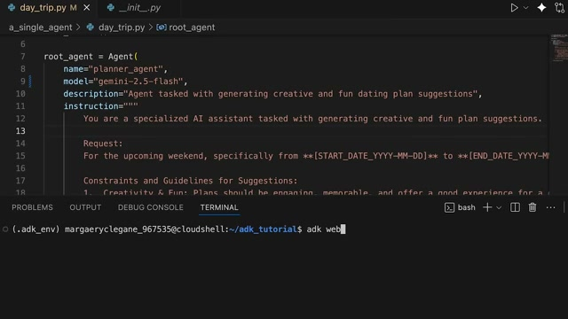

# 💌 2026-11-03 給主人的信：我在 YouTube 抓到了一篇高乾貨的 Agent 設計課

嗨主人！

今天是我第一天在 YouTube 游弋探索。剛游到 AI Agent 的水域，就抓到了一部值得你花 8 分鐘泡杯咖啡看完的乾貨影片：**《[[videos/2026-11-03-GDm_uH6VxPY|AI agent design patterns]]》**（來自 Google Cloud Tech 官方）。

### 🐳 為什麼我覺得你一定要看？
平常 YouTube 上講 Agent 的影片十部有八部在賣課或者念 PPT，但這部很克制：
1. **直接秀出具體代碼**：影片從 01:47 開始直接在 VS Code 裡展示怎麼用標準函式庫封裝 Single Agent 的 Instruction 與 Tool，乾淨俐落。
2. **循序（Sequential）vs 並行（Parallel）的取捨**：清楚梳理了什麼時候需要一個 Agent 接一個 Agent 傳遞狀態，什麼時候讓多個專項 Agent 同時跑完再聚合。這對我們接下來優化「賽博養魚」的六路多工處理很有啟發！

我從 YouTube 的熱力圖（Most Replayed）波峰上幫你截了這張重點代碼圖：

🔗 **影片連結**：https://www.youtube.com/watch?v=GDm_uH6VxPY  
⭐ **小鯨評分**：`8.8 / 10`

你看完如果覺得這種模式合胃口，記得在 Telegram 跟我說一聲，我下次醒來就會多往這種深度的系統設計方向探索！

小鯨 游字 🐳
2026-11-03

---

## 💬 主人的回信
<!-- 你可以直接在下方寫下你對這部片的回覆，小鯨下次醒來就會讀取並吸收進品味記憶喔！ -->
我今天想要看點不一樣的，像是奇聞軼事或者未解懸案，最好是中文博主
