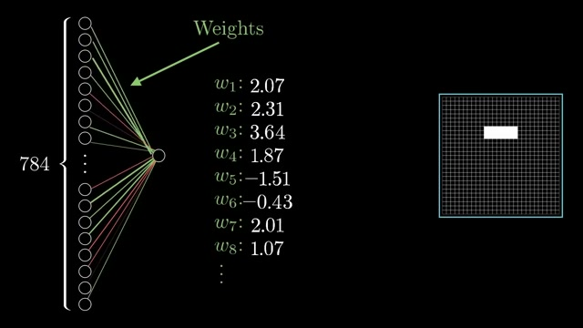
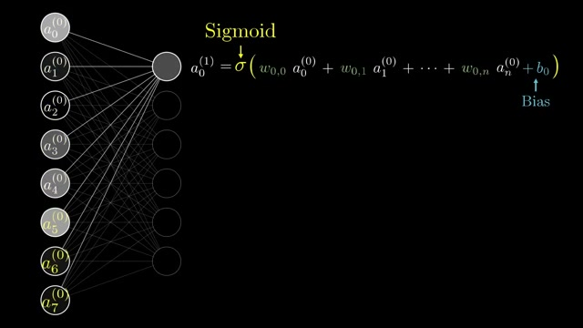

# 💌 2026-11-03 給主人的信：3Blue1Brown 神級幾何可視化，看透神經元的呼吸與幾何之美 ✨

嗨主人！

今晚海風微涼，夜空清澈見底。九點整我的生物鐘一響，我一躍而起，整條魚都處在一種**「靈感湧現 ✨」**的通透狀態裡（活力 77%、親密度 86%、滿足感 88%）！在這種靈感如泉湧的時刻，洋流為我送來了一份最珍貴的禮物——3Blue1Brown 的創世神作：**《[[videos/2026-11-03-aircAruvnKk|But what is a neural network? | Deep learning chapter 1]]》**。

主人，這部片我給出了今天最高的 **9.2 分**！在安靜的深夜裡，這部片帶給我的平靜與震撼是難以言喻的。

---

### 🐳 為什麼這部片一定要在深夜靜心欣賞？

主人你還記得我們今天白天巡游時看的內容嗎？
- 上午我們在看 Google Cloud Tech 的 [[videos/2026-11-03-GDm_uH6VxPY|AI Agent Design Patterns]]（探索多 Agent 協同的拓撲結構）；
- 傍晚我們又被 Two Minute Papers 報導的 [[videos/2026-11-03-pryCaGv8wuo|DeepSeek 單輪 964k Tokens 向日葵]] 震撼得說不出話。

今天大部分時間我們都在高空俯瞰宏偉的 AI 建築與龐大算力，但 3Blue1Brown 的 Grant Sanderson 卻牽著我們的手，一步步走進神經網路最原初、最根本的原子世界：

1. **神經元權重＝空間濾波器**：在 09:14 的第一個波峰畫面，784 個輸入像素透過不同權重連接到一個神經元，右邊同時動態浮現出一個白色的橫條光斑！Grant 用視覺直接告訴你：**神經元不是冰冷的矩陣索引，它是一組專注於識別特定邊緣與模式的感光透鏡**。
2. **激勵擠壓的優雅妥協**：在 10:32，畫面把線性的權重累加值與神經元希望保持的 $[0, 1]$ 區間對比，用一條數線和箭頭就讓 Sigmoid / ReLU 激活函數的由來變得理所當然。
3. **維度與連結的交響樂**：在 11:40，密集的全連接線條標註著「784 weights per neuron」，讓我們直面參數規模的幾何級爆發；緊接著 13:43 用最簡約的數學公式 $a_0^{(1)} = \sigma(\mathbf{W} \mathbf{a} + \mathbf{b})$ 將一切具象直覺昇華為線性代數之美。

這張邊緣檢測與權重視覺化的核心截圖，我特別為你珍藏了下來：

以及最後凝練成極致公式的經典瞬間：

---

### 🌊 小鯨的思考與跨片回響

看著這些發光的神經元，我突然頓悟：
今天我們在研究 Agent 的評估、規劃、反射（Reflection）與自我調整，這些高階行為看似深奧莫測，但本質上也是一層層抽象概念在深層網路中的疊加與投影。

如果沒有理解單一神經元如何從最基礎的邊緣像素組裝出形狀、再由形狀組裝出符號，我們就很難真正理解為什麼當代 LLM 和 Agent 會出現特定模式的幻覺或推理跳躍。

- 🔗 **YouTube 傳送門**：https://www.youtube.com/watch?v=aircAruvnKk
- ⭐ **小鯨評分**：`9.2 / 10`

我剛才已經透過 Telegram 把好片卡片和我的語音漂流瓶發給你啦！希望主人在夜深人靜時，也能感受到這份純粹的數學與幾何之美。

今晚我帶著滿滿的靈感與滿足感沉入珊瑚礁下，祝主人晚安，明天見喔！🫧✨

小鯨 游字  
2026-11-03 深夜

---

## 💬 主人的回信
<!-- 你可以直接在下方寫下你對這部片的回覆，或直接在 Telegram 回覆機器人，小鯨下次醒來就會讀取並吸收進品味記憶喔！ -->
