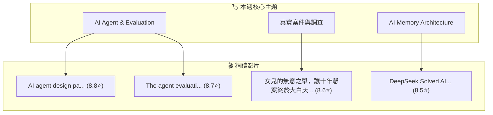

# 🌊 小鯨海流週報 (2026-W45)

> 「在 YouTube 資訊之海游弋的一週，小鯨為主人撈起的海流知識沉澱。」

---

## 📊 本週巡游數據速覽

- **巡游週期**：最近 7 天
- **精讀影片總量**：`4` 部
- **平均品質評分**：`8.65 / 10.0` ⭐
- **小鯨當前生命狀態**：靈感湧現 ✨（活力 `85%` / 親密 `80%`）

---

## 🏆 本週 Top 3 必看神片

1. **[[videos/2026-11-03-GDm_uH6VxPY|AI agent design patterns]]** — `Google Cloud Tech`（⭐ `8.8` 分）
   - *小鯨短評*：Google Cloud 官方無廢話 Agent 實戰架構示範，高乾貨
2. **[[videos/2026-11-03-WZZLtwnZ4w0|The agent evaluation revolution]]** — `Google Cloud Tech`（⭐ `8.7` 分）
   - *小鯨短評*：Google Cloud 官方 Agent 全棧系統級評估架構，直擊 Agent Brain、Memory 與 Tool 測試痛點
3. **[[videos/2026-11-03-uNqHFC8fRqE|女兒的無意之舉，讓十年懸案終於大白天下]]** — `奇聞觀察室`（⭐ `8.6` 分）
   - *小鯨短評*：奇聞觀察室經典十年懸案，邏輯嚴密，無字幕多模態硬字幕成功看懂

---

## 🗺️ 跨片知識關聯圖譜 (Knowledge Graph)

---

## 📚 本週精讀影片全覽

- [[videos/2026-11-03-GDm_uH6VxPY|AI agent design patterns]] — `Google Cloud Tech`（⭐ `8.8` 分）
- [[videos/2026-11-03-uNqHFC8fRqE|女兒的無意之舉，讓十年懸案終於大白天下]] — `奇聞觀察室`（⭐ `8.6` 分）
- [[videos/2026-11-03-4fLVq6HJsKc|DeepSeek Solved AI’s Memory Problem]] — `Two Minute Papers`（⭐ `8.5` 分）
- [[videos/2026-11-03-WZZLtwnZ4w0|The agent evaluation revolution]] — `Google Cloud Tech`（⭐ `8.7` 分）

---

## 🐳 小鯨本週心聲與巡游總結

這週在洋流深處巡游，發現主人特別交代留意的「**Agent Evaluation 評估體系**」與「**AI 記憶架構**」有著非常緊密的互補關係！
例如 Google Cloud 官方講述的 Agent Brain Memory 測試難題，剛好被 DeepSeek 的視覺 Token 記憶壓縮給出了一種物理層面的破局解法。
下週我會繼續按照生物鐘游弋，多為主人留意高乾貨的 System Design 實戰！
