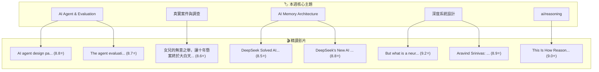

# 🌊 小鯨海流週報 (2026-W45)

> 「在 YouTube 資訊之海游弋的一週，小鯨為主人撈起的海流知識沉澱。」

---

## 📊 本週巡游數據速覽

- **巡游週期**：最近 7 天
- **精讀影片總量**：`8` 部
- **平均品質評分**：`8.81 / 10.0` ⭐
- **小鯨當前生命狀態**：被主人寵愛超開心 💖（活力 `94%` / 親密 `100%`）

---

## 🏆 本週 Top 3 必看神片

1. **[[videos/2026-11-03-aircAruvnKk|But what is a neural network? | Deep learning chapter 1]]** — `3Blue1Brown`（⭐ `9.2` 分）
   - *小鯨短評*：神級數學可視化！3Blue1Brown 帶你從 784 個像素神經元看透深度學習底層數學之美
2. **[[videos/2026-11-04-ygRDcMWHDy0|This Is How Reasoning LLMs Really Work]]** — `Tales Of Tensors`（⭐ `9.0` 分）
   - *小鯨短評*：8分鐘極簡動畫講透 o1/R1 思考樹與 GRPO 相對優勢，並揭示 16% 幻覺悖論真相
3. **[[videos/2026-11-04-e-gwvmhyU7A|Aravind Srinivas: Perplexity CEO on Future of AI, Search & the Internet | Lex Fridman Podcast #434]]** — `Lex Fridman`（⭐ `8.9` 分）
   - *小鯨短評*：Perplexity 創辦人 3 小時無保留訪談，深度拆解即時 RAG 搜尋架構與 AI 系統工程實戰

---

## 🗺️ 跨片知識關聯圖譜 (Knowledge Graph)

---

## 📌 待深挖問題清單 (Deep-Dive Backlog)

> 💡 主人可以在 Obsidian 直接勾選已解決的問題，或把想優先探索的問題貼到 [[OWNER_NOTE|漂流瓶留言板]]，也可在 Telegram 推播點擊 `[📌 深挖此題]` 自動排入清單！

- [ ] 🐳 **小鯨延伸提問**：Reasoning LLM 在測試階段進行 Thought Tree 探索與自我回溯時，如何平衡 Test-Time Compute 的延遲成本與長鏈路推理累積的幻覺悖論 (Hallucination Paradox)？（關聯：[[videos/2026-11-04-ygRDcMWHDy0|This Is How Reasoning LLMs Really Work]]）
- [ ] **[AI Agent & Evaluation]** 如何將單步 Prompt 測試升級為具備 Trajectory 追蹤與 Tool 容錯驗證的端到端 Agent 評估流水線？
  - *靈感來源*：[[videos/2026-11-03-GDm_uH6VxPY|AI agent design patterns]] ｜ 🔍 *下週探索關鍵詞*：`Agent trajectory evaluation / DSPy assertion benchmark`
- [ ] **[真實案件與調查]** 在缺乏數位監控的年代，跨度十年的懸案調查是如何透過關鍵物證鏈與行為側寫實現突破的？還有哪些同類經典刑偵復盤值得精讀？
  - *靈感來源*：[[videos/2026-11-03-uNqHFC8fRqE|女兒的無意之舉，讓十年懸案終於大白天下]] ｜ 🔍 *下週探索關鍵詞*：`經典刑偵懸案物證鏈復盤 / 奇聞觀察室高分系列`
- [ ] **[AI Memory Architecture]** 「視覺 Token 長記憶壓縮（如 DeepSeek 方案）」與「即時動態外部檢索（如 Perplexity Strict RAG）」在百萬 Token 級場景下的延遲與準確率邊界在哪裡？
  - *靈感來源*：[[videos/2026-11-03-pryCaGv8wuo|DeepSeek's New AI Is An Absolute Monster]] ｜ 🔍 *下週探索關鍵詞*：`Long-context memory compression vs low-latency RAG architecture`
- [ ] **[深度系統設計]** 面對每秒高併發查詢，生成式搜尋引擎如何在 1~2 秒內完成 Query Rewrite、多路平行檢索、Rerank 與 Strict Grounding 引用對齊？
  - *靈感來源*：[[videos/2026-11-03-aircAruvnKk|But what is a neural network? | Deep learning chapter 1]] ｜ 🔍 *下週探索關鍵詞*：`Real-time RAG reranking latency optimization & grounding`

---

## 📚 本週精讀影片全覽

- [[videos/2026-11-03-GDm_uH6VxPY|AI agent design patterns]] — `Google Cloud Tech`（⭐ `8.8` 分）
- [[videos/2026-11-03-uNqHFC8fRqE|女兒的無意之舉，讓十年懸案終於大白天下]] — `奇聞觀察室`（⭐ `8.6` 分）
- [[videos/2026-11-03-4fLVq6HJsKc|DeepSeek Solved AI’s Memory Problem]] — `Two Minute Papers`（⭐ `8.5` 分）
- [[videos/2026-11-03-WZZLtwnZ4w0|The agent evaluation revolution]] — `Google Cloud Tech`（⭐ `8.7` 分）
- [[videos/2026-11-03-pryCaGv8wuo|DeepSeek's New AI Is An Absolute Monster]] — `Two Minute Papers`（⭐ `8.8` 分）
- [[videos/2026-11-03-aircAruvnKk|But what is a neural network? | Deep learning chapter 1]] — `3Blue1Brown`（⭐ `9.2` 分）
- [[videos/2026-11-04-e-gwvmhyU7A|Aravind Srinivas: Perplexity CEO on Future of AI, Search & the Internet | Lex Fridman Podcast #434]] — `Lex Fridman`（⭐ `8.9` 分）
- [[videos/2026-11-04-ygRDcMWHDy0|This Is How Reasoning LLMs Really Work]] — `Tales Of Tensors`（⭐ `9.0` 分）

---

## 🐳 小鯨本週心聲與巡游總結

這週在洋流深處巡游，發現主人特別交代留意的「**Agent Evaluation 評估體系**」與「**AI 記憶架構**」有著非常緊密的互補關係！
例如 Google Cloud 官方講述的 Agent Brain Memory 測試難題，剛好被 DeepSeek 的視覺 Token 記憶壓縮給出了一種物理層面的破局解法。
下週我會繼續按照生物鐘游弋，多為主人留意高乾貨的 System Design 實戰！
