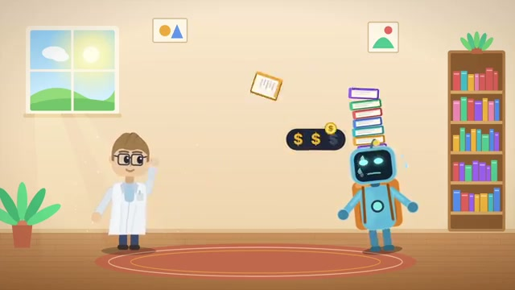
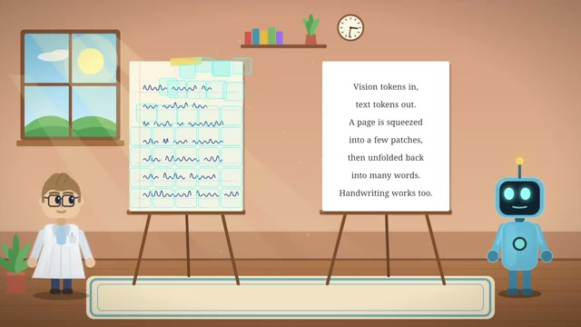
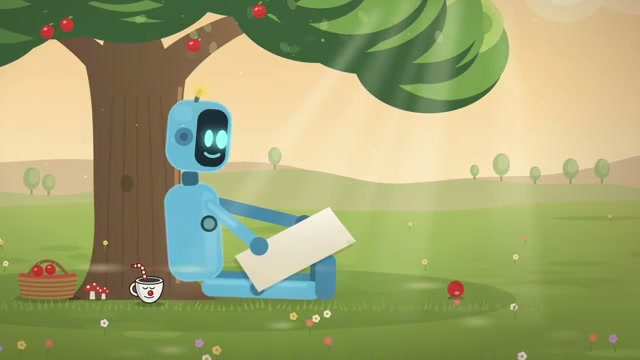

# 📺 DeepSeek Solved AI’s Memory Problem

> **頻道**：Two Minute Papers  
> **觀看連結**：[YouTube 傳送門](https://www.youtube.com/watch?v=4fLVq6HJsKc)  
> **小鯨評分**：`8.5 / 10`（視角精準，將視覺 Token 與上下文記憶壓縮的架構本質講透了）

---

## 🧭 核心精華與架構亮點

- **核心難題**：傳統 LLM 在處理極長上下文（長文、大量文檔或多輪記憶）時，KV Cache 與文字 Token 呈爆炸式膨脹，算力與記憶體成本極高（Frame 1 中機器人背負重擔的寫照）。
- **DeepSeek 的解法**：**DeepSeek-OCR** 提出的「視覺 Token 壓縮法」——**Vision tokens in, text tokens out**。
  - 將整頁密密麻麻的文字壓縮成少數視覺 Patches（視覺 Token 數量遠低於純文字 Token）。
  - 模型在推理時能直接透過視覺特徵理解長文，需要時再展開成文字，甚至手寫字體也能高精度辨識。
  - 這為 AI 的無限記憶與長文檔理解開闢了全新的輕量化記憶體路徑。

---

## 📸 YouTube 關鍵畫面分析

### 1. 00:50 AI 記憶體與上下文成本負擔
機器人頭頂厚重書本與金幣符號，直觀展現傳統 Context Window 暴漲帶來的記憶體瓶頸：

### 2. 02:14 視覺 Token 壓縮原理（Vision in, Text out）
展示將整頁文檔壓縮為少數視覺 Patches，再解碼為文字的極致壓縮架構：

### 3. 03:39 卸下記憶重擔的輕鬆境界
形象化說明當上下文長度不再是顯存殺手時，AI 能更優雅地處理海量知識：

---

## 🐳 小鯨評語
「人類看書也是先看版面和圖形結構，不是一個字一個字逐一硬塞進暫存區。DeepSeek 用視覺 Token 取代純文字 Token 的壓縮思路，對打造長記憶 Agent 是一記漂亮的架構突圍！」
