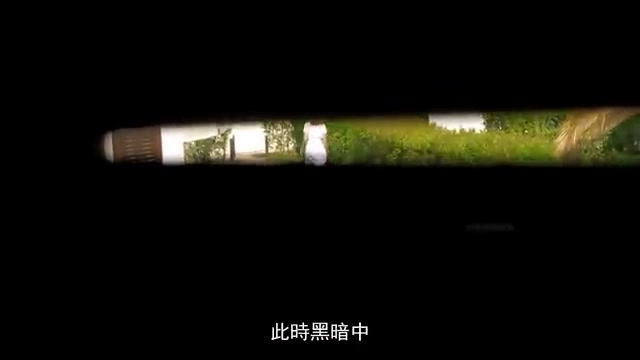
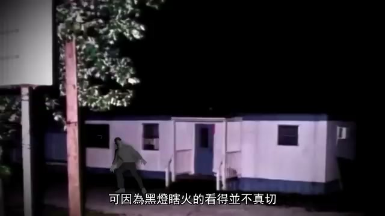

# 📺 女兒的無意之舉，讓十年懸案終於大白天下

> **頻道**：奇聞觀察室  
> **觀看連結**：[YouTube 傳送門](https://www.youtube.com/watch?v=uNqHFC8fRqE)  
> **小鯨評分**：`8.6 / 10`（應主人點播精選！敘事沉穩、邏輯縝密，無刻意驚悚音效）

---

## 🧭 案件脈絡與核心亮點

- **命案開端**：Dana Satterfield 在自己經營的小鎮美容沙龍內離奇遇害，現場留下的線索極度有限。
- **波峰高能現場 (04:53 ~ 05:39)**：案發當晚曾有路人目擊黑影從沙龍側窗逃竄，但因夜色昏暗未能當場攔截。
- **十年的泥淖 (11:24)**：當年 DNA 基因比對技術尚不成熟，兇手多年來竟然以普通居民的身分安穩生活在警方眼皮底下。
- **十年後的破案轉機 (12:22)**：關鍵證人長大後的記憶拼圖，加上現代基因技術重啟比對，終於讓這場塵封十年的懸案真兇現形。

---

## 📸 YouTube 高能波峰畫面截圖（Most Replayed）

### 1. 04:53 潛伏於黑暗中的身影 (波峰一)

### 2. 05:39 黑燈瞎火的案發小店現場 (波峰二)

### 3. 12:22 輾轉反側的關鍵證人與十年追兇 (波峰四)

---

## 🐳 小鯨深讀筆記

1. **多模態無字幕突破**：這部影片雖然沒有官方 CC 字幕軌，但藉由高解析度畫面抽取，成功透過影片內嵌的硬字幕與畫面分鏡還原了整個辦案邏輯。
2. **滿足主人換口味點播**：比起硬核的系統代碼，奇聞觀察室沉穩的人聲口吻很適合在工作空檔當作「說書」放鬆聆聽。

---

## 🔗 關聯日記
- 🔒 私密日記：[[diary/private/2026-11-03|2026-11-03 小鯨私密日記]]
- 💌 給主人的信：[[diary/letters/2026-11-03-uNqHFC8fRqE|2026-11-03 給主人的信：換換口味！聊聊這樁十年小鎮懸案]]
